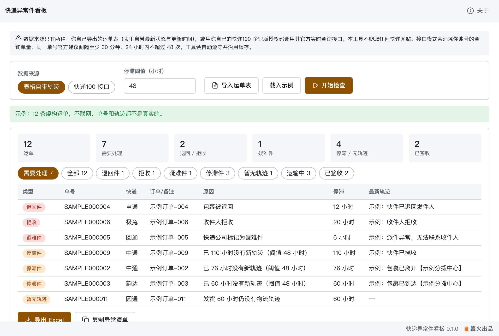

# 快递异常件看板

> 篝火出品 · 收录于篝火 App 应用区

找出停滞件、退回件、疑难件、拒收件，导出异常清单。

> **数据来源与合规（风险等级：低）**：只有两种来源——① 你自己导出的运单表（表里自带最新物流状态和更新时间）；② 你自己的快递100 企业版授权码，调用其官方实时查询接口。本工具**不使用任何未授权的爬虫**。工具只在界面里列出和导出异常件，不会自动发消息；需要推送请配合「企微告警推送」等工具。



## 下载

到 [Releases](https://github.com/campfire-code/express-exception-board/releases/latest) 下载对应安装包：

| 电脑 | 文件 |
|---|---|
| Windows 10 / 11 | `express-exception-board_版本号_windows-x64-setup.exe` |
| Mac（Apple 芯片） | `express-exception-board_版本号_mac-arm64.dmg` |
| Mac（Intel 芯片） | `express-exception-board_版本号_mac-x64.dmg` |

第一次打开：
- **Windows**：如果弹出「Windows 已保护你的电脑」，点「更多信息」→「仍要运行」。
- **Mac**：如果提示「无法验证开发者」，打开「系统设置 → 隐私与安全性」，在下方点「仍要打开」。

## 怎么用

### 先准备运单表

用你自己的店铺后台 / ERP / 快递月结单导出 .xlsx 或 .csv 运单表。**必须有「快递单号」列**（表头可叫 运单号、物流单号等）。可选列：快递公司、手机号、订单号/备注、发货时间；如果还带有 **物流状态、最后更新时间、最新轨迹**，就可以不联网直接判断。

### 两种数据来源

1. **表格自带轨迹**：读表里的物流状态、最后更新时间、最新轨迹，按文字判断（含「签收」「退回」「拒收」「疑难」等关键词）。不联网，不需要任何账号。
2. **快递100 接口**：表里没有轨迹时用。需要你自己的快递100 企业版授权码（customer）和 Key（官方文档：<https://api.kuaidi100.com/document/5f0ffb5ebc8da837cbd8aefc>）。授权码只保存在本机，只发往 `https://poll.kuaidi100.com/poll/query.do`。

### 判定规则

| 类型 | 条件 |
|---|---|
| 退回件 | 状态为退回（6）或退签（4），或最新轨迹含「退回 / 退件」 |
| 拒收 | 状态为拒签（14），或高级状态码 203 |
| 疑难件 | 状态为疑难（2）或清关异常（13），高级状态码 201～210 会写明具体原因 |
| 停滞件 | 在途 / 揽收 / 派件 / 清关中，且最近一条轨迹距今超过阈值（默认 48 小时，可调）；或接口返回高级状态码 202（超时未更新） |
| 暂无轨迹 | 没有任何轨迹，且发货时间距今超过阈值 |
| 已签收 / 运输中 | 其余情况 |

状态码、高级状态码含义以快递100 官方文档为准（已核实 0～8、10～14 及 201～210、301～304 等的列表）。

### 操作步骤

1. 先点「载入示例」再点「开始检查」，体验完整流程（12 条虚构运单，不联网）。
2. 点「导入运单表」选文件，或把文件拖进窗口。读完会提示表里有没有轨迹列。
3. 选数据来源、调整停滞阈值。接口模式填入授权码与 Key。
4. 点「开始检查」。列表默认只显示需要处理的运单，可按类型筛选。
5. 点「导出 Excel」（工作表：异常件、全部、说明，保存到「下载」文件夹的「快递异常件看板」目录），或「复制异常清单」粘贴给同事。

### 说明与限制

- 接口模式用 `resultv2=4` 请求，官方说明该参数会额外返回高级状态；签名为 `MD5(param + key + customer)` 转大写，已对照官方文档。
- 官方提示：同一单号查询间隔至少 30 分钟、24 小时内不超过 48 次。工具在本机记录每个单号的查询时间，不足 30 分钟就沿用上次结果、不再请求。
- 顺丰、中通必须提供手机号（官方要求）。工具只检查编码为 `shunfeng`、`zhongtong` 的运单；顺丰快运的编码未核实。
- 常用快递公司名称到编码的对照（顺丰、中通、申通、韵达、极兔、邮政、EMS、京东、德邦）按常见写法填写，官方文档只在示例中出现了 `yuantong`，**其余编码未逐个核实**；表里可以直接写快递100 的编码代替公司名。
- 请求之间的间隔 0.3 秒是本工具的保守取值；官方文档没有给出每秒请求数限制（未核实）。收到 503（签名错误）、504（请求过多）、601（Key 过期或无单量）会中止后续查询以免浪费单量。
- 测试使用按官方文档字段编写的模拟响应，**没有用真实授权码验证过**；真实账号下的表现、计费方式未核实。
- 只在界面里展示与导出，不会自动推送消息。

## 验收用例

1. 打开工具，点「载入示例」，点「开始检查」。应得到：12 运单、7 需要处理、退回/拒收 2、疑难件 1、停滞/无轨迹 4、已签收 2（示例时间相对当前时间生成，阈值默认 48 小时）。
2. 点「导出 Excel」，打开文件：工作表「异常件」（7 行）、「全部」（12 行）、「说明」，首行加粗冻结。
3. 点「导入运单表」选 `samples/运单表-带轨迹.csv`（7 条）。提示「表里带有最新状态和更新时间」。选「表格自带轨迹」点「开始检查」，应得到：需要处理 5 条——退回件 SAMPLE000003、拒收 SAMPLE000005、疑难件 SAMPLE000004、停滞件 SAMPLE000002、暂无轨迹 SAMPLE000007；已签收 1（SAMPLE000006）；SAMPLE000001 的更新时间写成 2099 年，只是为了让它无论何时打开都算正常。把阈值改成 1 小时，结果不变。
4. 导入 `samples/运单表-无轨迹.csv`（4 条）。应提示表里没有最新状态 / 更新时间列，并自动切到「快递100 接口」。不填授权码点「开始检查」，应提示「接口模式需要填写快递100 的授权码（customer）和 Key」，不发出请求。
5. 自动化验收：`pnpm test`，35 个用例覆盖 MD5 标准向量与签名、读表、响应解析、各类判定、频率保护、503 中止、Excel 读回。
6. 真实账号验收（需要你自己的授权码，作者未做）：导入 `samples/运单表-无轨迹.csv` 的格式但换成你自己的 3～5 个真实运单，用接口模式检查，对照快递官网核对状态；30 分钟内再点一次，应显示「沿用本机缓存」。

## 自己编译

需要 Node.js 22、pnpm、Rust。

```bash
pnpm install
pnpm test          # 单元测试
pnpm tauri dev     # 开发运行
pnpm tauri build   # 打包
```

界面框架在 `src/kit`（所有 campfire-code 工具共用），本工具的逻辑在 `src/tool`。

## 归属

本工具由**篝火**出品，是篝火 App 应用区收录的开源工具之一，由篝火（GitHub 组织 [campfire-code](https://github.com/campfire-code)）维护与更新。全部工具的目录见 [toolkit-hub](https://github.com/campfire-code/toolkit-hub)。

## 许可证

MIT，版权方为篝火（campfire-code）。
